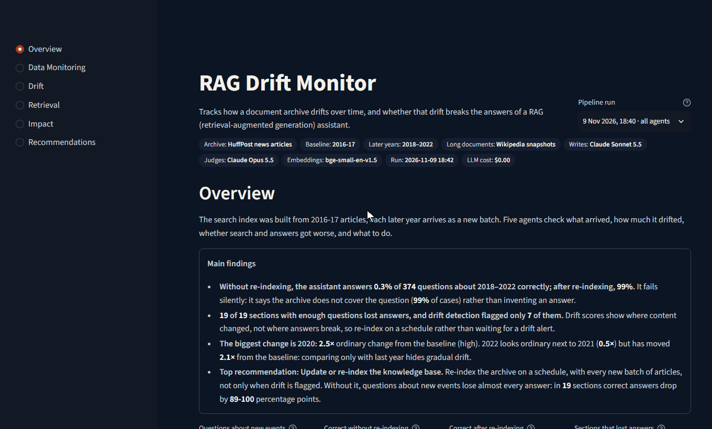
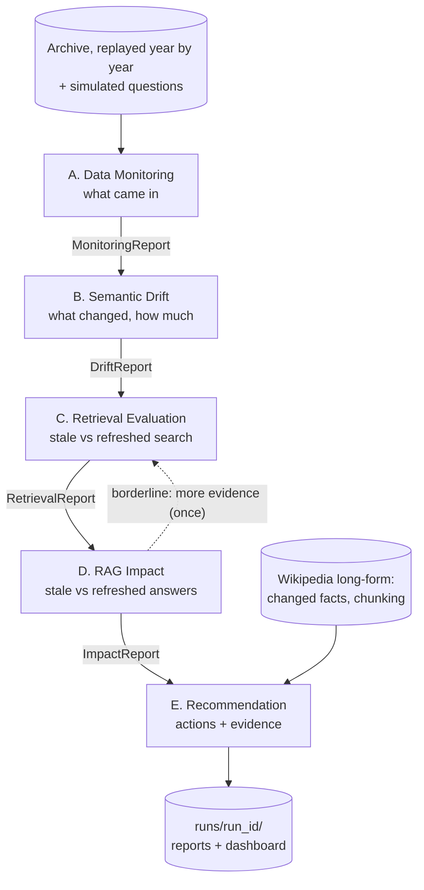

# RAG Drift Monitor

An agentic system that watches a retrieval-augmented (RAG) assistant, detects
how its documents and questions drift over time, measures whether that drift
actually hurts answers, and recommends what to do, with the evidence attached.
Every part serves one question: **which drift matters?**



*The dashboard, from the committed demo run: headline numbers → answers
stale vs refreshed → a section that lost every answer yet was never flagged
→ the evidence behind the top recommendation.*

*Take-home project for Rivvun AI ("Semantic Drift Detection & RAG Quality
Assurance"), November 2026. Brief: [`docs/project-brief.md`](docs/project-brief.md).*

**Contents:** [Results](#results) · [Architecture](#architecture) ·
[Key design decisions](#key-design-decisions) · [Quick start](#quick-start) ·
[More detail](#more-detail) · [Documentation](#documentation)

---

## Results

**Setting.** A newsroom archive assistant answering journalists' questions
from the [HuffPost News Category Dataset](https://www.kaggle.com/datasets/rmisra/news-category-dataset)
(77,840 articles, 2016–2022), replayed one year at a time. 165 long Wikipedia
articles, captured at each year end, cover long and edited documents.

**Key experiment.** The same questions are answered from a **stale index**
(2016–17 only) and a **refreshed index** (rebuilt each year). The difference
is the causal cost of not keeping up with drift.


| Finding | Numbers |
|---|---|
| Not re-indexing loses almost every answer about new events | **0.3% correct on the stale index vs 99% refreshed** (374 questions, 2018–22); baseline-year questions 100% on both |
| It fails silently, not wrongly | The stale index declines to answer; 1 of 374 answers added a claim from outside the articles |
| **Drift scores do not predict where the harm is** | All 19 sections with enough questions lose answers; 12 were never flagged; drift vs loss Spearman −0.19 to 0.41, all p > 0.1 |
| Comparing only with last year hides gradual drift | 2022 vs 2021: 0.5× ordinary change; 2022 vs the baseline: 2.1× |
| Emerging words match real events | coronavirus (2020), vaccine and capitol (2021), Russia and invasion (2022) |
| Changed facts change answers, but hide from drift scores | Edits that replaced a number or date changed the answer 50% of the time (vs 2%, Fisher p = 1.5e-10); 95% of those articles scored "low" drift |
| Applying the fix: re-indexing only the 90 flagged articles | Outdated answers 12.9% -> 3.0% (changed facts 68% -> 0%) for 64% of the re-embedding; it removed 77% of what a full re-index removes, short of the 80% set in advance, so it is paired with a scheduled full re-index (F24) |
| Questions in newer wording ("COVID" for "coronavirus") | Only 18 of 370 questions had a natural newer wording; search still found the article for 17 (F23) |

**Recommended** (5 actions, 4 ruled out with the number that ruled them out):
re-index on a schedule rather than only on drift alerts; re-index the 90
Wikipedia articles with changed facts, then a scheduled full re-index; send 12 unflagged sections to a person;
chunk long documents; keep monitoring older questions. Full text:
[`recommendations.md`](demo/runs/20261109-184053/recommendations.md).

---

## Architecture

Five LangGraph agents, each reading the reports of the ones before it.
Routing is decided in code: after B, a full evaluation or a small regression
check; after D, a borderline section goes back to C once for more evidence.

<details>
<summary><b>Show the agent flow diagram</b></summary>



</details>

| Agent | Does |
|---|---|
| **A. Data Monitoring** | Volume, length, section mix, new terms and sections, data quality per year |
| **B. Semantic Drift** | Embedding drift (MMD with a permutation test) and word drift (Jensen–Shannon divergence) per year and section, rated against ordinary change; emerging topics, words that changed meaning, query drift |
| **C. Retrieval Evaluation** | Retrieves every question from both indexes; an LLM judge grades relevance without knowing which index |
| **D. RAG Impact** | Answers every question from both indexes, grades each answer, measures the loss per section with a bootstrap interval, tests drift scores against the loss |
| **E. Recommendation** | One coded rule per action in the brief decides; an LLM explains; explanations with numbers not in the evidence are rejected |

Contracts, the detailed diagram and storage: [`docs/architecture.md`](docs/architecture.md).
Built with LangGraph, `bge-small-en-v1.5` embeddings, FAISS, Claude Sonnet 5.5
and Opus 5.5, Streamlit + Altair, and pytest.

---

## Key design decisions

The reasoning, options and evidence for each are in
[`docs/decisions.md`](docs/decisions.md) under the numbers shown.

| Decision | Instead of | Why |
|---|---|---|
| **The LLM writes; code decides.** Statistics, thresholds and recommendations are tested Python; the LLM writes questions, answers, judgements and explanations | An LLM agent choosing actions | Decisions are repeatable, testable and auditable. Explanations are checked number by number against the evidence (D1, D29) |
| **Stale vs refreshed index on the same questions** | Drift scores alone | Measures the harm directly. It is how we learned that drift scores miss where the harm is (D2, D25, D28) |
| **Severity measured against the archive's own ordinary change** | p-values or fixed thresholds | At this sample size every comparison is "significant", even 2017 vs 2016. A multiple of normal year-to-year change separates drift from noise (D11, D30) |
| **Two drift techniques: meaning (embeddings) and wording (vocabulary)** | One measure | They disagree after 2020, and the disagreement says what kind of drift it is (D10, D12) |
| **Routing in code, loop capped at once** | An LLM supervisor picking the next agent | Same input, same path; every route has a test (D1) |
| **Different models write and judge; the judge is blind to the index; checked against hand labels** | One model grading its own work | Avoids self-preference and index bias. Judges agree with people on 11–14 of 15 and are stricter when they differ (D9, D15, D28) |
| **A Wikipedia long-form set plus a changed-facts text check** | HuffPost only | News items are too short for chunking to matter, and embeddings barely move when only a number changes (D26, D27) |
| **FAISS on disk; the dashboard reads saved runs** | A hosted vector database; live calls in the dashboard | No server to run, exact search at 78k vectors, and a demo cannot fail on a live call (D22) |

---

## Quick start

No API key, GPU or dataset needed. Python 3.11+ (tested on 3.13, Windows 11).

```bash
git clone https://github.com/rahulleoak/rag-drift-monitor.git
cd rag-drift-monitor
python -m venv .venv
.venv\Scripts\Activate.ps1          # Windows; macOS/Linux: source .venv/bin/activate
pip install -r requirements.txt
pip install -e .

streamlit run app/streamlit_app.py  # the dashboard, from the committed demo run
pytest                              # 146 tests, ~20 s, synthetic data and a fake LLM
```

With no local runs, the dashboard shows the run committed under
[`demo/runs/`](demo/runs/), exactly as the full pipeline produced it. Nothing
is recomputed and no model is called. With an NVIDIA GPU, install
`pip install torch --index-url https://download.pytorch.org/whl/cu128` first
for faster embedding.

<details>
<summary><b>What each dashboard page shows</b></summary>

Pick a page in the left bar and a run at the top right; the top bar lists what
produced the run (archive, years, models, cost). Each section states this run's
finding under its heading; the ⓘ icon explains how to read the chart.

| Page | What it shows |
|---|---|
| Overview | The main findings, headline numbers, drift per year, the most drifted groups |
| Data Monitoring | Agent A: new sections and new words per year, section shares over time, data quality, the question stream |
| Drift | Agent B: drift by section and year, share of sections flagged, one group in detail (words before and after), topics that grew, words that changed meaning, question drift |
| Retrieval | Agent C: answer found in the top 5, stale vs refreshed, with examples; old questions after re-indexing |
| Impact | Agent D: correct answers stale vs refreshed; drift score against lost answers; examples; the Wikipedia edited-documents test |
| Recommendations | Agent E: each action with its explanation, scope and evidence, and the actions ruled out |

</details>

---

## More detail

<details>
<summary><b>How the LLM is used, and how the judges were checked</b></summary>

| Job | Model | Checked by |
|---|---|---|
| Write test questions and reference answers from sampled articles | Sonnet 5.5 | Code checks, two independent Opus reviews, hand labels |
| Judge whether a retrieved article answers a question | Opus 5.5 | Blind hand labels from two people |
| Answer questions from the retrieved articles (the RAG step) | Sonnet 5.5 | The answer judge |
| Judge each answer: correct, grounded, declined | Opus 5.5 | Blind hand labels |
| Explain each recommendation | Sonnet 5.5 | Code: every number must appear in the evidence |

No real query log or relevance labels exist, so the judges were checked
against blind hand labels (first passes):

| Check | Judge vs each person | Person vs person |
|---|---|---|
| Relevance: "does this article answer the question?" | 14/15 and 11/15 | 12/15 |
| Changed-facts check (precision) | 17/20 and 16/20 | 17/20 |
| Answer judge (one labeller) | 11/15 | – |

Where judge and person disagree, the judge is almost always the stricter, so
the losses are not inflated. Bulk jobs use the Batch API at half price; the
whole project cost about **$15.60** in LLM calls, logged per call. Labelling
rules: [`docs/labelling-guide.md`](docs/labelling-guide.md); details:
[`docs/findings.md`](docs/findings.md) F19–F20.

</details>

<details>
<summary><b>Long documents and chunking</b></summary>

Every Wikipedia article is longer than the 512 tokens the embedding model
reads (median 7,300 to 8,500). Articles are split at section headings, then
into pieces of about 256 tokens with 32 of overlap. How well each way of
reading an article follows its real edits (rank correlation with the true
amount of changed text):

| Method | Score |
|---|---|
| First 512 tokens only | 0.51 |
| One averaged vector per article | 0.78 |
| Chunks of 256 tokens | 0.87 |
| Chunks of 128 tokens | 0.89 |

Even chunk-level drift barely moves when only a number changes, so a
changed-facts check matches each edited sentence to its earlier version and
flags replaced numbers and dates. Details: [`docs/findings.md`](docs/findings.md) F16–F18.

</details>

<details>
<summary><b>Reproducing everything from scratch</b></summary>

Needs the dataset, an Anthropic API key and about **$15** of LLM calls,
mostly for writing and reviewing the question set. Every step caches its
work, so an interrupted step can be rerun without paying twice.

1. Download `News_Category_Dataset_v3.json` from
   [Kaggle](https://www.kaggle.com/datasets/rmisra/news-category-dataset) into
   `data/raw/` (size and SHA-256 are checked against the config).
2. Copy `.env.example` to `.env` and set `ANTHROPIC_API_KEY`. Spending is
   capped by `llm.budget_usd` in the config.

Run from the repository root. LLM steps accept `--estimate` or `--dry-run`
to print the cost without spending.

| # | Command | What it does | LLM |
|---|---|---|---|
| 1 | `python scripts/prepare_data.py` | Assigns years, cleans, removes near-duplicates, embeds every article | No |
| 2 | `python scripts/generate_questions.py --name full --full --batch` | Writes and reviews the test questions | Yes, the largest cost |
| 3 | `python scripts/fetch_wikipedia.py` | Downloads the 165 Wikipedia articles at each year end, cleans and chunks them | No |
| 4 | `python scripts/longform_drift.py` | The chunking experiment and the changed-facts check | No |
| 5 | `python scripts/outdated_answers.py` | Do changed facts change the answer? | Yes |
| 6 | `python scripts/run_pipeline.py` | All five agents; every report saved to `runs/<run_id>/` | Yes |
| 7 | `python scripts/make_charts.py` | Drift charts for the run and for `docs/figures/` | No |
| 8 | `python scripts/export_demo.py` | Copies the run to `demo/runs/` for the dashboard | No |

Without a key, `python scripts/run_pipeline.py --no-judge` runs A and B in
full and C without the judge; E marks what it could not check. Hand labels:
`python scripts/label_sheet.py make --run runs/<run_id>` writes a blind sheet;
`score` and `compare` measure agreement; `python scripts/recommend.py` reruns
Agent E with them. If a Batch API wait is interrupted, run the same command
again: it collects the batch it already submitted.

</details>

<details>
<summary><b>Project layout</b></summary>

```text
rag-drift-monitor/
├── app/streamlit_app.py      the dashboard (reads saved runs only)
├── config/config.yaml        every path, period, model, threshold and seed
├── demo/runs/                a committed pipeline run: the dashboard works without a key
├── docs/                     decisions, findings, architecture, journal
├── scripts/                  command-line entry points (steps above)
├── tests/                    pytest suite: synthetic data, fake LLM, no network
└── driftmon/                 the library
    ├── agents/               the five LangGraph nodes; thin wrappers over the modules below
    ├── graph.py              LangGraph wiring and the routing decisions
    ├── schemas.py            the typed reports agents pass to each other
    ├── policy.py             Agent E's rules: one per action in the brief
    ├── config.py             loads config/config.yaml and resolves paths
    ├── drift/                drift statistics: embedding, lexical, severity, topics,
    │                         term-context shift, changed facts
    ├── evaluation/           retrieval metrics, answers and judging, the outdated-answer
    │                         test, hand-label agreement, bootstrap statistics
    ├── data/                 loading and cleaning the archive, periods, the simulated
    │                         questions, Agent A's statistics
    ├── rag/                  embeddings, stale and refreshed FAISS indexes
    ├── llm/                  the LLM client (cache, Batch API, budget, cost log) and prompts
    ├── longform/             Wikipedia snapshots, chunking, the chunking experiment
    └── dashboard/            charts and loading saved runs
```

Created as you run and ignored by git: `data/` (except `data/sample/`),
`cache/` (embeddings and LLM replies), `indexes/` and `runs/`.

</details>

<details>
<summary><b>Configuration</b></summary>

Every threshold, path and model lives in
[`config/config.yaml`](config/config.yaml), with a comment saying why.

| Section | Controls |
|---|---|
| `paths` | Data, caches, indexes, runs and the demo |
| `periods` | The baseline (2016–17), the later years, the drift sample size |
| `data_cleaning`, `categories` | Cleaning rules; renamed sections that are merged |
| `embeddings`, `retrieval` | The embedding model; top k for retrieval and judging |
| `simulation`, `evaluation` | How test questions are sampled; which question set is used |
| `drift` | Significance level, permutations, severity bands |
| `impact` | What counts as a material loss; minimum questions per section |
| `recommendation` | Agent E's thresholds; where long-form and hand-label evidence is read |
| `longform` | The Wikipedia sample, chunk size and overlap, the outdated-answer test |
| `llm` | Models, prices, per-job settings, Batch API, the spending cap |
| `seed` | One seed for every random sample |

</details>

<details>
<summary><b>Assumptions and limitations</b></summary>

- **Years are replayed as batches** to simulate continuous monitoring; there
  is no live feed.
- **The questions are simulated** from sampled articles, as no real query log
  exists, so query drift partly mirrors document drift.
- **Small validation samples:** 15–20 hand-labelled items per judge, by two
  people (one for the answer judge).
- **43 year-by-section groups** had fewer than 8 questions and are reported
  but not classified.
- **The LLM has read Wikipedia,** so answers are judged on being grounded in
  the retrieved text, not only on being true.
- **The changed-facts check covers numbers and dates,** not changed names;
  precision 80–85%.
- **The second embedding model was not built:** its rule exists and reports
  "not needed", because every section recovers after re-indexing.
- **Recommendations are not applied automatically;** the refreshed index is
  itself the re-indexed system, so E cites that comparison.

</details>

<details>
<summary><b>Glossary</b></summary>

| Term | Meaning here |
|---|---|
| **Baseline** | 2016–17: the archive when the stale index was built |
| **Stale / refreshed index** | Search over baseline articles only / over every year up to the one tested |
| **Section** (segment) | One year × one HuffPost category, e.g. "2020 WELLNESS" |
| **Ordinary change** | How much the archive moves between periods inside the baseline; drift is a multiple of it |
| **Flagged** | Drift both significant and at least "medium" severity |
| **Material loss** | Correct answers drop by at least 10 points and the 95% interval excludes zero |
| **Drift that hurts / harm without drift** | A material loss in a flagged / an unflagged section |
| **Historical control** | Questions about the baseline years; they should score the same on both indexes |
| **Changed fact** | An edited sentence in which a number or date was replaced |

</details>

---

## Documentation

| If you want to know… | Read |
|---|---|
| How the system fits together | [`docs/architecture.md`](docs/architecture.md) |
| Why each choice was made, with the options considered | [`docs/decisions.md`](docs/decisions.md) (D1–D30) |
| Every result, with numbers and the command that reproduces it | [`docs/findings.md`](docs/findings.md) (F1–F22) |
| How each requirement in the brief is covered | [`docs/requirements-coverage.md`](docs/requirements-coverage.md) |
| Questions asked of the stakeholder, and the answers | [`docs/questions.md`](docs/questions.md) |
| What happened day by day, including dead ends | [`docs/journal.md`](docs/journal.md) |
| The hand-labelling rules | [`docs/labelling-guide.md`](docs/labelling-guide.md) |
