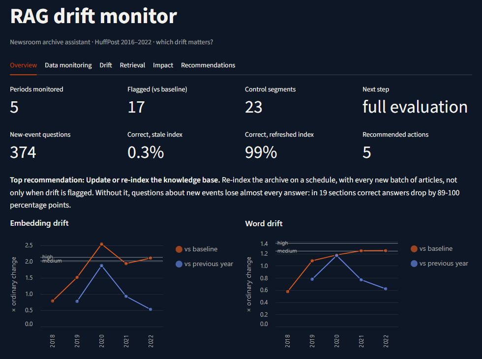
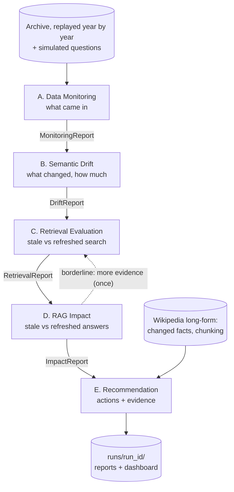
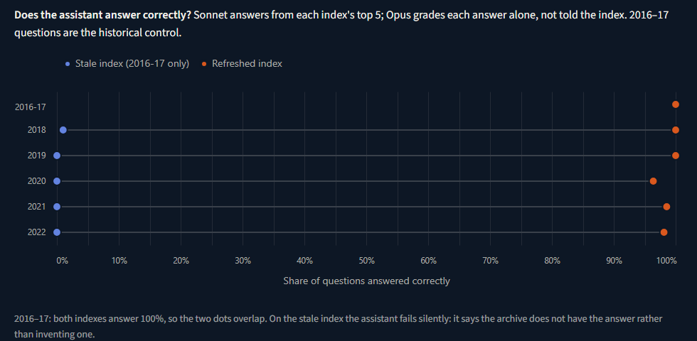

# RAG Drift Monitor

An agentic system that watches a retrieval-augmented (RAG) assistant over a
document archive, detects how the documents and the questions drift over
time, measures whether that drift actually hurts retrieval and answers, and
recommends what to do about it, with the evidence attached.

Every part of it serves one question: **which drift matters?**



*Take-home project for Rivvun AI ("Semantic Drift Detection & RAG Quality
Assurance"), November 2026. The brief is in
[`docs/project-brief.md`](docs/project-brief.md).*

---

## Contents

1. [The short version](#the-short-version)
2. [Quick start](#quick-start)
3. [How the system works](#how-the-system-works)
4. [Key results](#key-results)
5. [Reproducing everything from scratch](#reproducing-everything-from-scratch)
6. [Project layout](#project-layout)
7. [Configuration](#configuration)
8. [Technology choices](#technology-choices)
9. [Assumptions and limitations](#assumptions-and-limitations)
10. [Documentation map](#documentation-map)
11. [Glossary](#glossary)

---

## The short version

**The setting.** A newsroom archive assistant: journalists ask questions and
the assistant answers from the company's own article archive. The archive
is the [HuffPost News Category Dataset](https://www.kaggle.com/datasets/rmisra/news-category-dataset)
(77,840 cleaned articles, 2016–2022), replayed one year at a time as if new
articles were arriving. A second set of 165 long Wikipedia articles, each
captured at the end of every year, covers documents that are long (so
chunking matters) and are edited rather than replaced.

**The key experiment.** The same questions are answered twice: once from a
**stale index** (built from the 2016–17 baseline only) and once from a
**refreshed index** (rebuilt with each new year). The difference is the
causal cost of not keeping up with drift.

**What it found.**

- Without re-indexing, questions about new events lose almost every answer:
  **0.3% correct on the stale index vs 99% on the refreshed one** (374
  questions about 2018–2022). Questions about the baseline years stay at
  100% on both.
- The assistant fails **silently, not wrongly**: on the stale index it says
  the archive does not have the answer instead of inventing one.
- **Drift scores do not predict where the harm is.** Every section with
  enough questions lost answers, but 12 of those 19 were not flagged by
  drift detection, and no drift measure correlates with the size of the
  loss. New events inside a familiar topic do not move a section's overall
  profile.
- On edited documents, **changed numbers and dates are nearly invisible to
  embeddings**, yet they change the answer users get half the time (50% vs
  2% for rewordings). A plain text check catches them.

**What it recommends.** Re-index the archive on a schedule (not only on drift
alerts), re-index the 90 Wikipedia articles whose facts changed, send 12
sections to a person for review, chunk long documents, and keep monitoring
older questions. Four other actions were checked and ruled out, each with
the number that ruled it out.

---

## Quick start

### Requirements

- **Python 3.11 or newer** (developed and tested on Python 3.13, Windows 11).
- **No API key, GPU or dataset is needed** to explore the results or run the
  tests. A key and the dataset are only needed to
  [reproduce everything from scratch](#reproducing-everything-from-scratch).
- An NVIDIA GPU makes embedding the full archive faster; the CPU works too.

### 1. Install

```bash
git clone https://github.com/rahulleoak/rag-drift-monitor.git
cd rag-drift-monitor
python -m venv .venv
```

Activate the environment:

```bash
# Windows (PowerShell)
.venv\Scripts\Activate.ps1
# macOS / Linux
source .venv/bin/activate
```

Then install:

```bash
# Optional, with an NVIDIA GPU (on Windows, PyPI alone gives the CPU-only build):
pip install torch --index-url https://download.pytorch.org/whl/cu128

pip install -r requirements.txt
pip install -e .
```

### 2. Open the dashboard

```bash
streamlit run app/streamlit_app.py
```

It opens in your browser. With no local runs, it shows the run committed
under [`demo/runs/`](demo/runs/): every agent's report, the charts and the
recommendations, exactly as the full pipeline produced them. Nothing is
recomputed and no model is called.

| Tab | What it shows |
|---|---|
| Overview | Drift per year, answers stale vs refreshed, the top recommendation |
| Data monitoring | Agent A: what arrived each year, data quality, new sections, the query stream |
| Drift | Agent B: drift by section and year, emerging words and topics, words that changed meaning, query drift |
| Retrieval | Agent C: does the top 5 contain an answer, stale vs refreshed; how rankings changed |
| Impact | Agent D: correct answers stale vs refreshed; drift score vs loss per section; the Wikipedia outdated-answer test |
| Recommendations | Agent E: each action with its explanation and evidence, and the actions ruled out |

### 3. Run the tests

```bash
pytest
```

145 tests, about 20 seconds. They use small synthetic archives and a fake
LLM client, so they need no data, key or network.

### 4. Read the results in text form

The demo run's recommendations are readable on their own:
[`demo/runs/20261109-113214/recommendations.md`](demo/runs/20261109-113214/recommendations.md).

---

## How the system works

### Five agents in LangGraph



Each agent reads the reports of the agents before it, so removing one breaks
the next. Routing is decided in code: after B, a full evaluation or a small
regression check; after D, a borderline section goes back to C once for more
evidence.

| Agent | Reads | Does | Writes |
|---|---|---|---|
| **A. Data Monitoring** | Each year's documents and questions | Volume, length, section mix, new terms, new sections, data quality | `MonitoringReport` |
| **B. Semantic Drift** | A's report, embeddings | Two complementary techniques, per year and per section: **embedding drift** (MMD with a permutation test, centroid shift, novelty) and **word drift** (Jensen–Shannon divergence, emerging terms). Severity is judged against ordinary change inside the baseline, not p-values alone. Also emerging topics, words that changed meaning, and query drift | `DriftReport` |
| **C. Retrieval Evaluation** | B's flagged and control sections, the question set, both indexes | Retrieves for every question from the stale and the refreshed index; an LLM judge grades relevance blind to the index; ranking changes for old questions | `RetrievalReport` |
| **D. RAG Impact** | C's retrieval, B's drift scores | Answers every question from both indexes, grades each answer on its own, measures the loss per section with a bootstrap interval, classifies each section, relates drift scores to the loss | `ImpactReport` |
| **E. Recommendation** | B, C, D, the long-form results, the hand-label checks | One rule per action in the brief decides what to recommend; an LLM explains each recommendation; code rejects explanations with numbers not in the evidence | `RecommendationReport` |

Full contracts, the detailed diagram and the storage map are in
[`docs/architecture.md`](docs/architecture.md).

### Design principles

- **The LLM writes; code decides.** Statistics, thresholds and every
  decision are plain, tested Python. The LLM writes test questions, answers
  them, judges answers and explains recommendations. It never decides what
  is recommended.
- **Every claim has a number**, a significance check where one applies, and
  examples. Every recommendation carries its evidence or is rejected.
- **Thresholds are fixed before results.** For example, a section's loss is
  *material* only if correct answers drop by at least 10 percentage points
  and the 95% interval excludes zero.
- **Measured against ordinary change.** With thousands of articles almost
  any difference is "significant", so drift is reported as a multiple of
  what an ordinary period of news looks like.
- **Repeatable and cheap to rerun.** Embeddings and every LLM reply are
  cached on disk; a rerun of the full pipeline takes about 6 minutes and
  costs cents.

### Where the LLM is used

| Job | Model | Checked by |
|---|---|---|
| Write test questions and reference answers from sampled articles | Claude Sonnet 5.5 | Code checks, two independent Opus reviews, hand labels |
| Judge whether a retrieved article answers a question | Claude Opus 5.5 | Blind hand labels from two people |
| Answer questions from the retrieved articles (the RAG step) | Claude Sonnet 5.5 | The answer judge |
| Judge each answer: correct, grounded, declined | Claude Opus 5.5 | Blind hand labels |
| Explain each recommendation | Claude Sonnet 5.5 | Code: every number must appear in the evidence |

Different models write and judge, so the judge is not grading its own
style. The judge never sees which index an answer came from. Bulk jobs run
through the Batch API at half price; the whole project cost about **$15.60**
in LLM calls, logged per call in `runs/llm_costs.csv`.

### How the judges were validated

No real query log or human relevance labels exist, so the LLM's judgements
were checked against blind hand labels from two people:

| Check | Judge vs each person | Person vs person |
|---|---|---|
| Relevance: "does this article answer the question?" | 14/15 and 11/15 | 12/15 |
| Changed-facts check (precision) | 17/20 and 16/20 | 17/20 |
| Answer judge (one labeller) | 11/15 | – |

Where the judges disagree with a person, they are almost always the stricter
one, so the headline losses are not inflated by a lenient judge. These are
the first blind passes; how the labels were made is in
[`docs/findings.md`](docs/findings.md) (F19, F20) and the labelling rules in
[`docs/labelling-guide.md`](docs/labelling-guide.md).

### Long documents and chunking

HuffPost articles are a headline and one or two sentences, so the Wikipedia
set exists to make chunking matter: every article is longer than the 512
tokens the embedding model reads (median 7,300 to 8,500 tokens, depending
on the year). Articles are
split at section headings, then into pieces of about 256 tokens with 32
tokens of overlap.

How well each way of reading an article follows its real edits (rank
correlation with the true amount of changed text, 1 = perfect):

| Method | Score |
|---|---|
| First 512 tokens only | 0.51 |
| One averaged vector for the article | 0.78 |
| Chunks of 256 tokens | 0.87 |
| Chunks of 128 tokens | 0.89 |

Embedding only the start of an article misses edits further down; one
averaged vector dilutes a small change into the rest. Even chunk-level
drift barely moves when only a number changes, so a **changed-facts check**
matches each edited sentence to its earlier version and flags replaced
numbers and dates. Details: [`docs/findings.md`](docs/findings.md) F16–F18.

---

## Key results



| Finding | Numbers | Detail |
|---|---|---|
| Not re-indexing loses almost every answer about new events | Correct answers, 2018–2022 questions: 0–1% stale vs 96–100% refreshed; baseline questions 100% on both | F20 |
| The stale index fails silently | Declines when nothing relevant is found; 1 of 374 stale answers added a claim from outside the articles | F20 |
| Drift scores do not predict where the harm is | 19 of 19 sections with enough questions lose answers; 12 were not flagged (8 scored as ordinary drift, 4 belong to a section new since the baseline); Spearman of drift vs loss −0.19 to 0.40, all p > 0.1 | F20 |
| Comparing only with last year hides gradual drift | 2022 vs 2021 is 0.5× an ordinary period's embedding drift; 2022 vs the baseline is 2.1× | F22 |
| Emerging terms match real events | coronavirus and covid (2020), vaccine and capitol (2021), Russia and invasion (2022) | F4 |
| Changed facts change answers | Flagged edits: answer changed 50% of the time; edits that kept their numbers: 2% (Fisher p = 1.5e-10) | F21 |
| Changed facts hide from drift scores | 95% of articles with a changed fact had a "low" drift score | F18, F22 |
| Recommendations | 5 recommended, 4 ruled out; all 5 explanations passed the number check | F22 |

Each finding in [`docs/findings.md`](docs/findings.md) lists the exact
numbers, the command that reproduces it, and whether it supported or
contradicted what was expected.

---

## Reproducing everything from scratch

This needs the dataset, an Anthropic API key, and about **$15** of LLM calls
at Batch API prices, most of it for writing and reviewing the question set.
Every step caches its work, so a step that is interrupted can be run again
without paying twice.

### Setup

1. **Dataset.** Download `News_Category_Dataset_v3.json` from
   [Kaggle](https://www.kaggle.com/datasets/rmisra/news-category-dataset)
   into `data/raw/`. The preparation step checks the file's size and SHA-256
   against `config/config.yaml`.
2. **API key.** Copy `.env.example` to `.env` and set `ANTHROPIC_API_KEY`.
   `.env` is ignored by git. Spending is capped by `llm.budget_usd` in the
   config.

### Steps

Run from the repository root. Steps that call the LLM support `--estimate`
or `--dry-run`, which print the cost without spending anything.

| # | Command | What it does | LLM |
|---|---|---|---|
| 1 | `python scripts/prepare_data.py` | Assigns years, cleans, removes near-duplicates, embeds every article (`data/processed/documents.parquet`) | No |
| 2 | `python scripts/generate_questions.py --name full --full --batch` | Writes and reviews the test questions (`data/processed/questions_full.parquet`) | Yes, the largest cost |
| 3 | `python scripts/fetch_wikipedia.py` | Downloads the 165 Wikipedia articles at each year end (public API, responses cached), cleans and chunks them | No |
| 4 | `python scripts/longform_drift.py` | The chunking experiment and the changed-facts check (`runs/longform/`) | No |
| 5 | `python scripts/outdated_answers.py` | Do changed facts change the answer? (`runs/longform/outdated_*`) | Yes |
| 6 | `python scripts/run_pipeline.py` | All five agents; every report saved to `runs/<run_id>/` | Yes (retrieval and answer judging, explanations) |
| 7 | `python scripts/make_charts.py` | Drift charts for the run and for `docs/figures/` | No |
| 8 | `python scripts/export_demo.py` | Copies the run to `demo/runs/` for the dashboard | No |

Optional:

- **Hand labels** that check the judges: `python scripts/label_sheet.py make
  --run runs/<run_id>` writes a blind sheet; `score` and `compare` measure
  agreement. Afterwards, `python scripts/recommend.py` re-runs only Agent E
  so it can use them.
- **Without a key:** `python scripts/run_pipeline.py --no-judge` runs
  Agents A and B in full and C without the LLM judge. D has no answers to
  judge and says so; E works from what is available and marks the other
  actions "not checked".

The Batch API usually returns within an hour. If a run is interrupted while
waiting, run the same command again: it collects the batch it already
submitted.

---

## Project layout

```text
rag-drift-monitor/
├── app/streamlit_app.py      the dashboard (reads saved runs only)
├── config/config.yaml        every path, period, model, threshold and seed
├── demo/runs/                a committed pipeline run: the dashboard works without a key
├── docs/                     decisions, findings, architecture, journal (map below)
├── scripts/                  command-line entry points (steps above)
├── tests/                    pytest suite: synthetic data, fake LLM, no network
└── driftmon/                 the library
    ├── agents/               the five LangGraph nodes; thin wrappers over the modules below
    ├── graph.py              LangGraph wiring and the routing decisions
    ├── schemas.py            the typed reports agents pass to each other
    ├── policy.py             Agent E's rules: one per action in the brief
    ├── config.py             loads config/config.yaml and resolves paths
    │
    ├── drift/                drift statistics: embedding, lexical, severity bands, topics,
    │                         term-context shift, changed facts
    ├── evaluation/           retrieval metrics, answers and judging, the outdated-answer
    │                         test, hand-label agreement, bootstrap statistics
    │
    ├── data/                 what comes in: loading and cleaning the archive, periods,
    │                         the simulated questions, Agent A's statistics
    ├── rag/                  the pipeline under test: embeddings, stale and refreshed
    │                         FAISS indexes
    ├── llm/                  the LLM client (cache, Batch API, budget, cost ledger) and
    │                         every prompt, versioned
    ├── longform/             Wikipedia snapshots, chunking, the chunking experiment,
    │                         the long-form evidence Agent E reads
    └── dashboard/            charts and loading saved runs for the dashboard
```

Ignored by git and created as you run: `data/` (except `data/sample/`),
`cache/` (embeddings and LLM replies), `indexes/` and `runs/`.

---

## Configuration

Everything that could be a magic number lives in
[`config/config.yaml`](config/config.yaml), with a comment saying why.

| Section | Controls |
|---|---|
| `paths` | Where data, caches, indexes, runs and the demo live |
| `periods` | The baseline (2016–17) and the later years; the drift sample size |
| `data_cleaning`, `categories` | Cleaning rules; renamed sections that are merged |
| `embeddings`, `retrieval` | The embedding model, top k for retrieval and judging |
| `simulation`, `evaluation` | How test questions are sampled and which question set is used |
| `drift` | Significance level, permutations, severity bands |
| `impact` | What counts as a material loss; minimum questions per section |
| `recommendation` | Agent E's thresholds; where the long-form and hand-label evidence is read from |
| `longform` | The Wikipedia sample, chunk size and overlap, the outdated-answer test |
| `llm` | Models, prices, per-job settings, Batch API, the spending cap |
| `seed` | One seed for every random sample |

---

## Technology choices

| Component | Choice | Why | Decision |
|---|---|---|---|
| Orchestration | LangGraph | Typed shared state, conditional edges for routing and the evidence loop | Q14, D1 |
| Embeddings | `BAAI/bge-small-en-v1.5` (sentence-transformers) | Small, fast, strong on retrieval; runs locally | Q12 |
| Vector store | FAISS, exact search, saved to disk | No server to install; exact results at 78k vectors | D22 |
| LLM | Claude Sonnet 5.5 (writes), Claude Opus 5.5 (judges) | Different models for writing and judging; structured output | D9, D15 |
| Statistics | NumPy, SciPy, scikit-learn | Permutation tests, bootstrap intervals, Spearman, Fisher | D10, D11 |
| Dashboard | Streamlit + Altair | Reads saved runs, so a demo cannot fail on a live call | Q16 |
| Data | HuffPost (time-based drift), Wikipedia snapshots (long-form) | Real dated drift with a known event; long, edited documents | D3, D26 |

Considered and not adopted, with reasons: a hosted vector database (D22), a
knowledge graph (D21), and an LLM supervisor that picks the next agent
(Q14).

---

## Assumptions and limitations

- **Years are replayed as batches** to simulate continuous monitoring; there
  is no live data feed.
- **The questions are simulated.** No real query log exists, so an LLM
  writes them from sampled articles. Query drift therefore partly mirrors
  document drift by construction.
- **Small validation samples.** The judges are checked on 15–20 hand-labelled
  items per part, by two people (one for the answer judge).
- **Many sections are too small to classify.** 43 year-by-section groups had
  fewer than 8 questions and are reported but not classified.
- **The LLM has read Wikipedia,** so answers are judged on whether they are
  grounded in the retrieved text, not only on whether they are true.
- **The changed-facts check covers numbers and dates,** not changed names
  (for example a new office holder). Its precision is 80–85%.
- **165 Wikipedia articles** is a deliberate sample of about 1,000 core
  topics; a larger sample would tighten the per-article rates.
- **The second embedding model was not built.** The model-evaluation rule
  exists and reports "not needed", because every section recovers after
  re-indexing.
- **Recommendations are not applied automatically.** The refreshed index is
  itself the re-indexed system, so the recommendation cites that comparison.

---

## Documentation map

| If you want to know… | Read |
|---|---|
| What was asked | [`docs/project-brief.md`](docs/project-brief.md) |
| How the system fits together, agent by agent | [`docs/architecture.md`](docs/architecture.md) |
| Why each choice was made, with the options considered | [`docs/decisions.md`](docs/decisions.md) (D1–D29) |
| Every result, with numbers and how to reproduce it | [`docs/findings.md`](docs/findings.md) (F1–F22) |
| How each requirement in the brief is covered | [`docs/requirements-coverage.md`](docs/requirements-coverage.md) |
| The questions asked of the stakeholder, and the answers | [`docs/questions.md`](docs/questions.md) |
| What happened day by day, including dead ends | [`docs/journal.md`](docs/journal.md) |
| A two-page summary sent for feedback | [`docs/design-summary.md`](docs/design-summary.md) |
| Material for the walkthrough | [`docs/presentation.md`](docs/presentation.md) |
| The rules people used to hand-label the judges | [`docs/labelling-guide.md`](docs/labelling-guide.md) |

References such as **D22** point to a decision and **F20** to a finding;
**Q** and **P** numbers are design questions and proposals in
[`docs/questions.md`](docs/questions.md).

---

## Glossary

| Term | Meaning here |
|---|---|
| **Baseline** | 2016–17: the archive as it stood when the stale index was built |
| **Stale index** | Search over baseline articles only: the system if nobody re-indexed |
| **Refreshed index** | Search over the baseline plus every year up to the one tested |
| **Section** (segment) | One year × one HuffPost category, e.g. "2020 WELLNESS"; the unit for "which drift matters" |
| **Ordinary change** | How much the archive moves between periods inside the baseline; drift is reported as a multiple of it |
| **Flagged** | A section whose drift is both significant and at least "medium" severity |
| **Material loss** | Correct answers drop by at least 10 points, and the 95% interval excludes zero |
| **Drift that hurts / harm without drift** | A material loss in a flagged / an unflagged section |
| **Historical control** | Questions about the baseline years; they should score the same on both indexes |
| **Changed fact** | An edited sentence in which a number or date was replaced |
| **Evidence loop** | Agent D sending a borderline section back to Agent C once, to check the top 10 instead of the top 5 |
