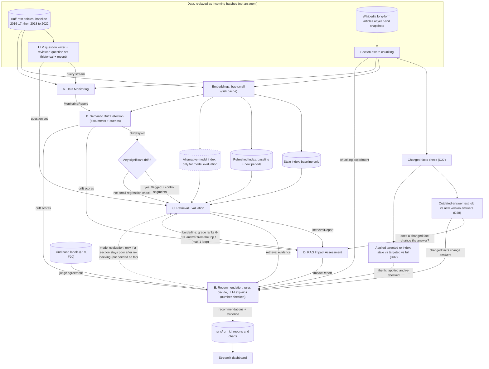

# Architecture

How the system is put together: the agents, what each one consumes and
produces, and how data flows between them. Keep this file and its Mermaid
diagram up to date whenever the agent design or data flow changes. UML views
of the code (packages, classes, the sequence of one run) are in
[`uml.md`](uml.md).

**Status (2026-11-09):** all five agents run in LangGraph
(A → B → route → C → D → E, with the loop from D back to C), with typed
reports, 202 tests and the Streamlit dashboard. Built: data cleaning, cached
embeddings, stale and refreshed FAISS indexes saved to disk (D22), document
and query drift (D11, D12, D24), the LLM layer (D15), the question set
(D23), retrieval evaluation (D25), answer quality and the segment classes
(D28), the Wikipedia long-form set with chunking (D26), the changed-facts
check (D27), the outdated-answer test (D28) and the applied targeted
re-index check (D32), all three run as scripts on the Wikipedia set, not as
graph nodes; Agent E reads their results) and Agent E's rules (D29). A
separate experiment, the newer-wording test (D31), checks a claim and does
not feed the agents. Not built: the alternative-model index (no section
needs it, D29). Items marked *(proposal Pn)* come from
`docs/questions.md` Part 4 (D5); items marked *(D7)* were added after
checking the design against every requirement (`docs/requirements-coverage.md`).

## 1. Overview

The system watches a RAG assistant over a document archive and answers one
question: **which drift matters?** It has three parts:

1. **Simulator** (`driftmon/data/simulate.py`, not an agent). Stands in for
   production: it releases the archive period by period as "new documents",
   and produces an unlabelled **query stream** (what users ask) plus a
   labelled **golden evaluation set** (question, reference answer, source
   document). Queries come from an LLM because no real query log exists.
   The golden set has a **historical** part (questions from baseline
   articles, the control) and a **recent** part (questions from each later
   period) *(D7)*. Questions in newer wording about older topics were
   planned as part of the set *(D7)*; they became a separate test instead
   (D31, F23), because only 5% of questions have a natural newer wording.
2. **RAG pipeline under test** (`rag/embeddings.py`, `rag/index.py`, `evaluation/answers.py`). Two
   indexes: **stale** (baseline period only) and **refreshed** (baseline plus
   the new period). Comparing them on the same questions isolates the effect of
   new data: the key experiment. A second, ready-made embedding model is
   designed for **model evaluation**: when re-indexing does not fix quality,
   the affected segments would be re-run with it *(D7)*; not built, because
   every section recovers on the refreshed index (D29). No model is trained.
3. **Five agents** (`driftmon/agents/`), wired with LangGraph (`graph.py`).
   Each reads earlier agents' reports from a typed shared state and writes one
   report of its own (`schemas.py`).

Design rule: agents are thin. Statistics, metrics and decisions live in plain,
unit-tested modules (`drift/`, `evaluation/`, `policy.py`) that never import
`llm/client.py`. The LLM writes questions, answers, judgements and explanations; it
never makes the decision.

## 2. Agent flow

Solid boxes are built and tested; dashed boxes are designed, not built yet.

## 3. Agents and their contracts

| Agent | Reads | Does | Writes (read by) |
|---|---|---|---|
| **A. Data Monitoring** | Period document batches, query stream | Fixes the baseline snapshot. Tracks volume, text length, category mix (chi-square), new-term rate, empty descriptions. Merges renamed sections (`categories.normalise`) and reports sections new since the baseline (e.g. U.S. NEWS) as a structural change, not drift (D6). Marks period × category segments with enough data. Summarises the query stream the same way (volume, new-term rate) *(D7)*. | `MonitoringReport` (B) |
| **B. Semantic Drift Detection** | `MonitoringReport`, embeddings | Technique 1: MMD + permutation test, per-document novelty, centroid shift, dispersion *(P3)*. Technique 2: Jensen–Shannon divergence and log-odds emerging terms. Each period is compared with the baseline and with the previous period *(P1)*, both as a whole and within each category, so a change in topic mix is not mistaken for a change in meaning (F2, D6). Benjamini–Hochberg correction; severity bands calibrated on within-baseline drift *(P7)*; lexical × semantic drift type *(P2)*. Also: the same techniques on the **query stream** (query drift) *(D7)*; **term-context shift** for key terms (how far the meaning of articles containing a term moves, and its neighbouring words before and after) *(D7)*; **emerging **emerging topics** by clustering each period's most novel articles, labelled with their top terms *(D7)*. Explanations are built in code (top words, example articles, severity as "× ordinary change"); no LLM in Agent B. | `DriftReport`: per-segment scores, p-values, severity, examples, drifted + control segments (C, D, E) |
| **C. Retrieval Evaluation** | `DriftReport`, golden eval set, both indexes | Saves each FAISS index to disk with a manifest and reloads it when the embeddings are unchanged (D22). Selects questions from drifted and control segments. Known-item MRR and Recall@K; LLM-judged Precision@K and nDCG@K over pooled results of both indexes. Per-segment deltas with bootstrap CIs; worst queries with what was retrieved. **Ranking change** between stale and refreshed for baseline questions: top-K overlap, share of newer articles, and whether the source article was displaced *(D7, D25)*. The judge grades the pooled top 5 of both indexes in one blind, shuffled call per question *(D25)*. Runs historical and recent questions separately *(D7)*. When E triggers model evaluation, re-runs the affected segments with the alternative embedding model *(D7)*. | `RetrievalReport` (D) |
| **D. RAG Impact Assessment** | `RetrievalReport` (top 5 per index, relevance grades), `DriftReport` | Sonnet answers every question from the stale and the refreshed top 5, only from those articles; Opus grades each answer on its own (correct 0/1/2, grounded, declined), not told the index *(D28)*. Code: loss in correct answers per segment with a bootstrap interval; material if at least 10 points and the interval excludes zero (fixed before results); the four classes and a likely cause (D13); Spearman of each drift measure vs the loss; whether declines were right (from C's grades); unanswerable questions. Historical questions are the control *(D7)*. A borderline segment goes back to C once: C grades ranks 6-10, D answers from the top 10 and concludes (confirmed / answers just outside the top 5 / escalate). On Wikipedia, the outdated-answer test checks whether flagged changed facts change answers, against edits whose numbers did not change *(D27, D28)*. | `ImpactReport` (E) |
| **E. Recommendation** | `ImpactReport`, `RetrievalReport`, `DriftReport`, `MonitoringReport`; long-form results (changed facts, outdated-answer test, chunking, the applied re-index) and hand-label checks (`driftmon/longform/evidence.py`) | `policy.py`: one rule per action in the brief (re-index; re-index specific documents; chunking; retrieval settings; prompts; model evaluation; retraining; escalate; continue monitoring). Every rule reports: recommended with evidence, not needed with the number that ruled it out, or not checked if an input is missing. A recommendation without evidence with numbers is rejected. Sonnet explains each recommended action from its evidence only; code rejects any number not in the evidence, retries once, else keeps the rule's text *(D29)*. Model evaluation would send C back to test a second embedding model *(D7)*; not built, because no section stays poor after re-indexing. | `RecommendationReport` → `recommendations.json`, `recommendations.md` (dashboard) |

**Why these dependencies are real:** C cannot choose what to test without B's
ranked segments; D reuses C's retrieved contexts and needs B's scores to relate
drift to quality; E's rules take D's classification as input. Removing any
agent breaks the next one.

**Conditional edges** (decided in Python, in `graph.py`):
- After B: if no segment drifted significantly, C runs only a small regression
  check (a small question set); D and E still run on it. The check still
  catches quality loss that happens without measurable drift.
- After D: if a segment's impact estimate is borderline (its confidence
  interval straddles the threshold), go back to C once for more questions.
- After E (designed, not built, D29): if quality is still poor on the
  refreshed index (re-indexing does not fix it), go back to C once to evaluate
  the alternative embedding model on the affected segments, then re-run E
  with that evidence *(D7)*. E's model-evaluation rule reports "not needed"
  on our data, with the number.

## 4. Data flow and storage

| What | Where | In git? |
|---|---|---|
| Raw datasets | `data/raw/` | No |
| Cleaned documents, all periods, with period and drift-sample flag | `data/processed/documents.parquet` | No |
| Cleaning reports (retention table, every removed document) | `runs/prepare/` (CSV) | No |
| Small committed sample | `data/sample/` | Yes |
| Embeddings (`cache/embeddings/<model>/`) and LLM responses (`cache/llm/<job>/`) | `cache/` | No |
| FAISS indexes (stale, refreshed per year) with manifests, from Agent C (D22) | `indexes/` | No |
| LLM cost ledger (every billed request) | `runs/llm_costs.csv` | No |
| Run outputs (reports, charts) | `runs/<run_id>/` | No |
| Long-form evidence Agent E read, saved with each run | `runs/<run_id>/longform/` | No |
| Separate experiments: newer wording (D31), applied re-index (D32) | `runs/wording/`, `runs/longform/reindex_*` | No |
| Demo run for the dashboard (reports, dark charts, long-form snapshot; about 1 MB), from `scripts/export_demo.py` | `demo/runs/<run_id>/` | Yes |
| Exploration tables | `runs/explore/<dataset>/` (CSV) | No |
| Charts for a run | `runs/<run_id>/charts/` (PNG) | No |
| Charts for the docs and slides | `docs/figures/` (light) and `docs/figures/dark/` (PNG, copies of the latest run) | Yes |
| Settings, periods, thresholds | `config/config.yaml` | Yes |

Every dataset is mapped onto one record shape (`doc_id, date, category,
title, text`) in `driftmon/data/records.py`, so switching datasets is a config change.

**Dashboard (Q16).** `app/streamlit_app.py` only reads saved runs, so a
demo cannot fail on a live LLM call. Pages (left bar): Overview, Data
Monitoring (A), Drift (B), Retrieval (C), Impact (D: answers stale vs
refreshed, drift score vs loss per section, the Wikipedia outdated-answer
test) and Recommendations (E: each action with its explanation and evidence,
and the actions ruled out). Charts are live Altair charts
(`driftmon/dashboard/live.py`); every "what this run shows" sentence is
built from the run's numbers (`driftmon/dashboard/story.py`). It reads `runs/` and falls back to the committed `demo/runs/`, so it
works straight after cloning, without an API key, a GPU or a rerun. One
optional page is live: **Ask the Archive** (`driftmon/dashboard/ask.py`,
D37) asks a typed question of the stale and a refreshed index with Agent D's
exact retrieval and prompt. It appears only where the documents, saved
indexes and an API key exist, so a fresh clone never shows it; the saved-run
pages never call the LLM.

**Storage (no database server).** Vector search uses FAISS exact
inner-product indexes held in memory and rebuilt from cached embeddings at
the start of a run (about a second for 78k vectors). Documents live in a
parquet file, embeddings in a numpy cache, LLM replies as JSON files, costs
in a CSV ledger. No Chroma, Qdrant or Neo4j: at this scale a server adds
installation for reviewers and approximate-search noise for no benefit
(Q13, D21).

## 5. Where the LLM is used (and where it is not)

| Step | LLM? | Why |
|---|---|---|
| Generating user questions and reference answers (simulator) | Yes | No real query log exists |
| Statistics, drift scores, significance, severity | No | Must be reproducible and testable |
| Explaining a flagged drift segment (B) | No | Built in code: top words, example articles, severity in plain words (planned as an LLM step; code was enough) |
| Naming emerging-topic clusters (B) | No | Clusters are labelled with their top terms |
| Retrieval relevance judgements on pooled results (C) | Yes | No human relevance labels; validated on a hand-labelled subset |
| Retrieval metrics (C) | No | Pure functions |
| Writing answers, judging answer quality (D) | Yes | The system under test, and the judge |
| Impact classification, correlations (D) | No | Decision logic |
| Choosing actions (E) | No | `policy.py` rules |
| Writing recommendation explanations (E) | Yes | From structured evidence; checked for citations |
