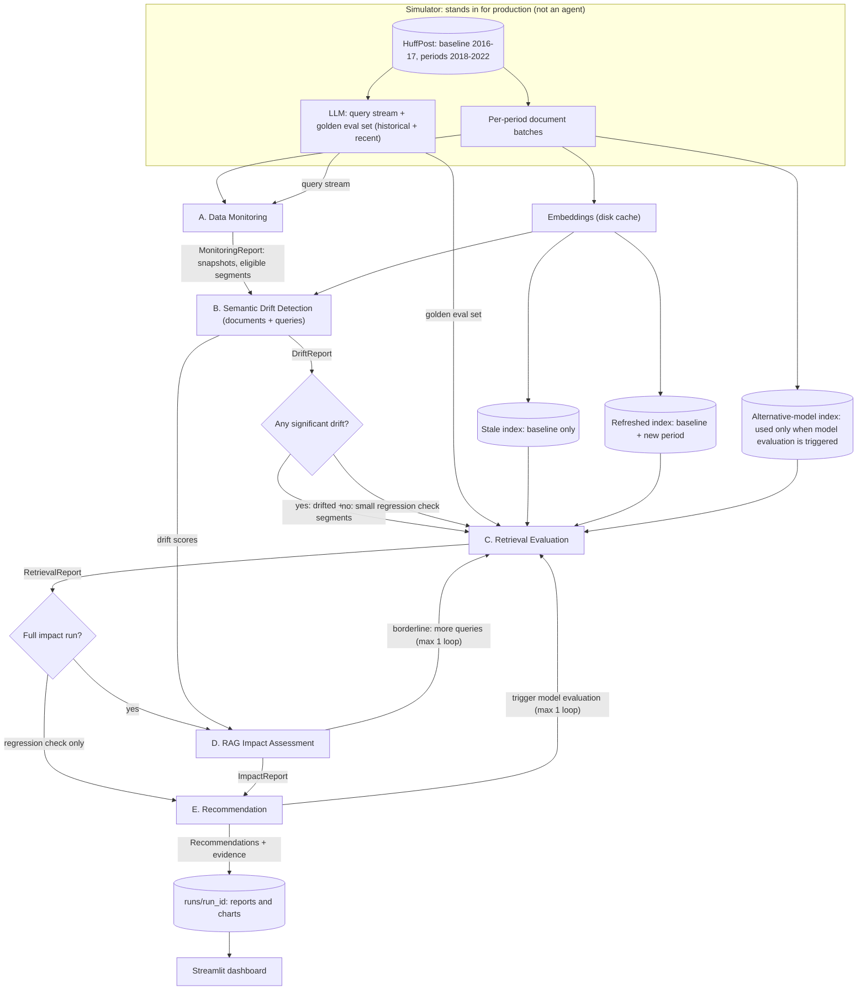

# Architecture

How the system is put together: the agents, what each one consumes and
produces, and how data flows between them. Keep this file and its Mermaid
diagram up to date whenever the agent design or data flow changes.

**Status (2026-11-04):** proposed design. The folder structure and module
stubs exist. Implemented: data loading (`driftmon/data.py`), exploration
(`scripts/exploration/`), periods (`driftmon/periods.py`), cleaning
(`driftmon/cleaning.py`, `scripts/prepare_data.py`), cached embeddings
(`driftmon/embeddings.py`), the stale and cumulative refreshed indexes
(`driftmon/index.py`, D10) and whole-period drift statistics for both
techniques (`driftmon/drift/`, `scripts/run_drift.py`, F4). **Agents A and B
run in LangGraph** (`driftmon/graph.py`, `scripts/run_pipeline.py`) with typed
reports (`MonitoringReport`, `DriftReport`), within-category comparisons and
severity bands (D11, F5), emerging topics, term-context shifts and the
measure-correlation check (D12, F6), and the routing decision after B.
Query drift waits for the LLM query stream. C, D and E are not built yet,
so both routes currently end the run. Charts (`driftmon/charts.py`,
`scripts/make_charts.py`) and a dashboard skeleton (`app/streamlit_app.py`,
reading saved runs via `driftmon/dashboard_data.py`) show A and B's results. Items marked *(proposal Pn)* come
from `docs/questions.md` Part 4 and were approved on 2026-11-04 (D5). Items
marked *(D7)* were added after checking the design against every requirement
in the assignment (`docs/requirements-coverage.md`).

## 1. Overview

The system watches a RAG assistant over a document archive and answers one
question: **which drift matters?** It has three parts:

1. **Simulator** (`driftmon/simulate.py`, not an agent). Stands in for
   production: it releases the archive period by period as "new documents",
   and produces an unlabelled **query stream** (what users ask) plus a
   labelled **golden evaluation set** (question, reference answer, source
   document). Queries come from an LLM because no real query log exists.
   The golden set has a **historical** part (questions from baseline
   articles, the control) and a **recent** part (questions from each later
   period) *(D7)*. Some recent queries are deliberately phrased in newer
   wording about older topics, so query drift is not just a copy of
   document drift *(D7)*.
2. **RAG pipeline under test** (`embeddings.py`, `index.py`, `rag.py`). Two
   indexes: **stale** (baseline period only) and **refreshed** (baseline plus
   the new period). Comparing them on the same questions isolates the effect of
   new data: the key experiment. A second, ready-made embedding model is kept
   for **model evaluation**: when re-indexing does not fix quality, the
   affected segments are re-run with it *(D7)*. No model is trained.
3. **Five agents** (`driftmon/agents/`), wired with LangGraph (`graph.py`).
   Each reads earlier agents' reports from a typed shared state and writes one
   report of its own (`schemas.py`).

Design rule: agents are thin. Statistics, metrics and decisions live in plain,
unit-tested modules (`drift/`, `evaluation/`, `policy.py`) that never import
`llm.py`. The LLM writes questions, answers, judgements and explanations; it
never makes the decision.

## 2. Agent flow

## 3. Agents and their contracts

| Agent | Reads | Does | Writes (read by) |
|---|---|---|---|
| **A. Data Monitoring** | Period document batches, query stream | Fixes the baseline snapshot. Tracks volume, text length, category mix (chi-square), new-term rate, empty descriptions. Merges renamed sections (`categories.normalise`) and reports sections new since the baseline (e.g. U.S. NEWS) as a structural change, not drift (D6). Marks period × category segments with enough data. Summarises the query stream the same way (volume, new-term rate) *(D7)*. | `MonitoringReport` (B) |
| **B. Semantic Drift Detection** | `MonitoringReport`, embeddings | Technique 1: MMD + permutation test, per-document novelty, centroid shift, dispersion *(P3)*. Technique 2: Jensen–Shannon divergence and log-odds emerging terms. Each period is compared with the baseline and with the previous period *(P1)*, both as a whole and within each category, so a change in topic mix is not mistaken for a change in meaning (F2, D6). Benjamini–Hochberg correction; severity bands calibrated on within-baseline drift *(P7)*; lexical × semantic drift type *(P2)*. Also: the same techniques on the **query stream** (query drift) *(D7)*; **term-context shift** for key terms (how far the meaning of articles containing a term moves, and its neighbouring words before and after) *(D7)*; **emerging topics** by clustering each period's most novel articles, labelled with their top terms *(D7)*. LLM explains flagged segments from the numbers and examples. | `DriftReport`: per-segment scores, p-values, severity, examples, drifted + control segments (C, D, E) |
| **C. Retrieval Evaluation** | `DriftReport`, golden eval set, both indexes | Selects questions from drifted and control segments. Known-item MRR and Recall@K; LLM-judged Precision@K and nDCG@K over pooled results of both indexes. Per-segment deltas with bootstrap CIs; worst queries with what was retrieved. **Ranking change** between stale and refreshed: top-K overlap, rank correlation, and which older articles were displaced by newer ones *(D7)*. Runs historical and recent questions separately *(D7)*. When E triggers model evaluation, re-runs the affected segments with the alternative embedding model *(D7)*. | `RetrievalReport` (D) |
| **D. RAG Impact Assessment** | `RetrievalReport`, `DriftReport` | Generates answers from both indexes; LLM judges correctness, groundedness, relevance. Quality deltas with CIs. Relates each drift signal to quality loss across segments. Classifies each segment: drift that hurts / drift that does not / quality loss without drift / healthy. Compares historical vs recent questions: historical questions are the control and should score about the same on both indexes *(D7)*. | `ImpactReport` (E); may send C back for more queries once |
| **E. Recommendation** | `ImpactReport` + B and C evidence | `policy.py` rules map evidence patterns to actions, one rule per action in the brief (see D7 for the triggers); LLM writes the explanation; a check rejects any recommendation without cited evidence. **Trigger model evaluation** is carried out, not just recommended: it sends C back to test the alternative model, and the result becomes evidence *(D7)*. | List of `Recommendation` (dashboard) |

**Why these dependencies are real:** C cannot choose what to test without B's
ranked segments; D reuses C's retrieved contexts and needs B's scores to relate
drift to quality; E's rules take D's classification as input. Removing any
agent breaks the next one.

**Conditional edges** (decided in Python, in `graph.py`):
- After B: if no segment drifted significantly, C runs only a small regression
  check and the flow skips D. The check still catches quality loss that
  happens without measurable drift.
- After D: if a segment's impact estimate is borderline (its confidence
  interval straddles the threshold), go back to C once for more questions.
- After E: if quality is still poor on the refreshed index (re-indexing does
  not fix it), go back to C once to evaluate the alternative embedding model on
  the affected segments, then re-run E with that evidence *(D7)*.

## 4. Data flow and storage

| What | Where | In git? |
|---|---|---|
| Raw datasets | `data/raw/` | No |
| Cleaned documents, all periods, with period and drift-sample flag | `data/processed/documents.parquet` | No |
| Cleaning reports (retention table, every removed document) | `runs/prepare/` (CSV) | No |
| Small committed sample | `data/sample/` | Yes |
| Embeddings (`cache/embeddings/<model>/`) and LLM responses | `cache/` | No |
| Run outputs (reports, charts) | `runs/<run_id>/` | No |
| Exploration tables | `runs/explore/<dataset>/` (CSV) | No |
| Charts for a run | `runs/<run_id>/charts/` (PNG) | No |
| Charts for the docs and slides | `docs/figures/` (PNG, copies of the latest run) | Yes |
| Settings, periods, thresholds | `config/config.yaml` | Yes |

Every dataset is mapped onto one record shape (`doc_id, date, category,
title, text`) in `driftmon/data.py`, so switching datasets is a config change.

## 5. Where the LLM is used (and where it is not)

| Step | LLM? | Why |
|---|---|---|
| Generating user questions and reference answers (simulator) | Yes | No real query log exists |
| Statistics, drift scores, significance, severity | No | Must be reproducible and testable |
| Explaining a flagged drift segment (B) | Yes | Turns numbers and examples into prose; the numbers come from code |
| Naming emerging-topic clusters (B) | Yes | Code finds the clusters and their top terms; the LLM only gives them a readable name |
| Retrieval relevance judgements on pooled results (C) | Yes | No human relevance labels; validated on a hand-labelled subset |
| Retrieval metrics (C) | No | Pure functions |
| Writing answers, judging answer quality (D) | Yes | The system under test, and the judge |
| Impact classification, correlations (D) | No | Decision logic |
| Choosing actions (E) | No | `policy.py` rules |
| Writing recommendation explanations (E) | Yes | From structured evidence; checked for citations |
