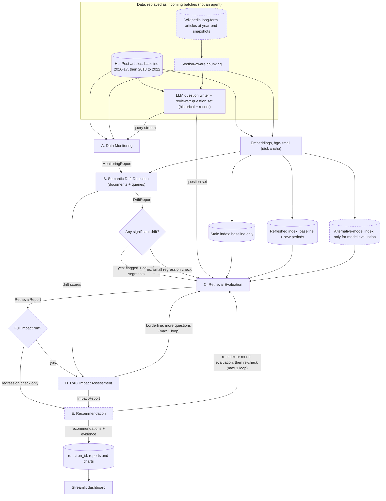

# Design summary for feedback

**Project:** Semantic Drift Detection & RAG Quality Assurance
**To:** Ani · **From:** Rahul · **Date:** 2026-11-06 · **Due:** Friday 2026-11-13

## 1. The problem and use case

A **newsroom archive assistant**: journalists ask questions over their own
article archive. As the news changes, the archive and the questions drift.
The system has to answer one question: **which drift matters**, meaning
which drift actually makes retrieval or answers worse, and what to do about
it.

## 2. Data

| Set | What | Why |
|---|---|---|
| **HuffPost News Category** (time-based drift) | 77,840 cleaned articles. Baseline 2016–17; new data arrives one year at a time, 2018–2022 | Real, dated drift with a known event to check against (COVID in 2020) |
| **Wikipedia, long-form** (chunking; planned, not built yet) | A sample of long articles, each captured as it stood at the end of each year, 2017–2022 | Long documents with sections, so chunking matters. The same article is edited over time, which is the "documents become outdated" case. Same years as HuffPost. |

## 3. Architecture and agents (LangGraph)

Solid boxes are built and tested; dashed boxes are designed, not built yet.

Each agent reads the previous agents' reports. Statistics and decisions are
plain, tested Python. The LLM writes test questions, answers, judgements and
explanations, but never makes the decision.

| Agent | Does | Status |
|---|---|---|
| **A. Data Monitoring** | Baseline snapshot. Tracks volume, length, category mix, new terms and new sections, for documents and for incoming queries | Built |
| **B. Semantic Drift** | Two techniques: embedding drift (MMD with a permutation test, centroid shift, novelty) and word drift (Jensen–Shannon divergence, log-odds emerging terms). Per period and per section. Severity is measured against ordinary year-to-year change, not just p-values. Also emerging topics, changing word meanings, and query drift | Built |
| *Route* | If nothing drifted, C runs a small regression check only | Built |
| **C. Retrieval Evaluation** | The key experiment: a **stale index** (baseline only) vs a **refreshed index** (with new data), on the same questions. LLM-judged precision@5, nDCG@5 and "answer in the top 5", plus MRR and Recall@10, with bootstrap confidence intervals. Results split by drifted vs control sections, and by whether old questions get pushed out by newer articles | Built; LLM judging about to run |
| **D. RAG Impact** | Answers from both indexes, judged for correctness and groundedness. Links each drift signal to quality loss. Labels each section as: drift that hurts / drift that doesn't / quality loss without drift / healthy | Next |
| **E. Recommendation** | Rules map evidence to the brief's actions (monitor, re-index, change chunking or embeddings, retrieval settings, prompts, model evaluation, human review). Every recommendation must cite its evidence or it is rejected. Bonus: apply re-indexing and re-check | Next |

Dashboard: Streamlit, reading saved runs, so it works without an API key.

## 4. Results so far (HuffPost)

- **2020 is the largest shift:** 5.7× an ordinary year in embedding drift.
  The most affected sections were lifestyle ones (Wellness, Food & Drink,
  Style), not politics.
- **Emerging terms match real events:** coronavirus and covid (2020),
  vaccine and capitol (2021), Russia and invasion (2022).
- **The two techniques disagree after 2020:** embedding drift eases while
  word drift keeps rising. That shows they measure different things.
- **Year-on-year monitoring alone misses drift:** 2022 vs 2021 looks
  ordinary (1.2×), but 2022 vs the baseline is 4.7×.
- **Query drift** is significant for every year (q ≤ 0.008). Word drift
  peaks in 2020–21 (coronavirus, covid, capitol).
- **Retrieval, stale vs refreshed index** (Opus grades the top 5 of both,
  blind to which index found what; 423 questions):

  | Questions from | Answer in top 5, stale | Answer in top 5, refreshed |
  |---|---|---|
  | 2016-17 (baseline, the control) | 100% | 100% |
  | 2018 to 2022 | 0–1% | 96–100% |

  - Without re-indexing, questions about new events fail almost completely.
    The stale index returns related but wrong articles: a 2020 question about
    takeout during the pandemic gets 2016 hepatitis and E. coli stories.
  - Re-indexing does not hurt old questions, even though by 2022 14% of
    their top 10 are newer articles.
  - **Drifted sections are not hit harder than stable ones**, either before
    or after re-indexing (refreshed: 99% vs 98% answered). On this archive,
    the drift that matters is new content missing from the index, not how
    far a section's meaning moved. Answer quality (Agent D) and the
    Wikipedia set, where the stale index holds an *outdated version of the
    same article*, test the subtler cases.
  - Caveat: the relevance judge is still being checked against hand labels.

## 5. Test questions and how they are validated

No real query log exists, so Sonnet writes questions from sampled articles
and Opus reviews them.

- **Validation:**
  - code checks;
  - two independent reviews per question;
  - the writer's and reviewer's question types are compared (85% agree);
  - the reviewer agrees with itself 95% of the time on a repeat review.
- **Result:** 423 answerable and 15 unanswerable questions kept, out of 653.
- **Hand check:** I hand-label a blind sample of questions, relevance grades
  and answers (about 40 items), and report agreement with the LLM judges
  (Cohen's kappa).
- **Total LLM spend so far:** $9.18, using our own key.

## 6. Chunking strategy and how it affects drift detection (planned)

The articles are downloaded and chunked; the drift comparison is not run
yet. One measurement already: every article in the sample is longer than
the 512 tokens the model reads (median about 8,000), so without chunking
about 90% of each article would never be seen.

**Strategy:**
- Split at section headings first, so a chunk never mixes two sections.
- Then make pieces of about 256 tokens with about 32 tokens of overlap. The
  embedding model (bge-small) reads at most 512 tokens.

**Why it matters for drift:** a long article has two common shortcuts, and
both hide drift.
- Embedding only the first 512 tokens makes a change further down
  invisible.
- Averaging one vector over the whole article dilutes a small new section
  into the rest.

**How we plan to show it:** compare drift detection on whole articles
(first 512 tokens, or one averaged vector) with detection on chunks. The
text that changed between two snapshots comes from Wikipedia's revision
history, so we know what really changed and can check what each way of
reading the article catches. The stale vs refreshed experiment then shows
the practical cost: the stale index returns the outdated version of the
same article.

## 7. Main assumptions and limitations

- Years are replayed as incoming batches to simulate continuous monitoring.
- The questions are written from each period's articles, so query drift
  partly mirrors document drift.
- The LLM judges are checked against hand labels, not replaced by them.
- The LLM has read Wikipedia, so answers are judged on whether they are
  grounded in the retrieved text.

## 8. Feedback welcome on

1. Is Wikipedia at yearly snapshots a good choice for the long-form set,
   with company annual reports (SEC 10-K) as the fallback?
2. Does comparing whole-article and chunked drift detection answer "how chunking affects drift
   detection" in the way you expected?
3. For the bonus, is applying re-indexing and re-checking a good choice of
   fix?
