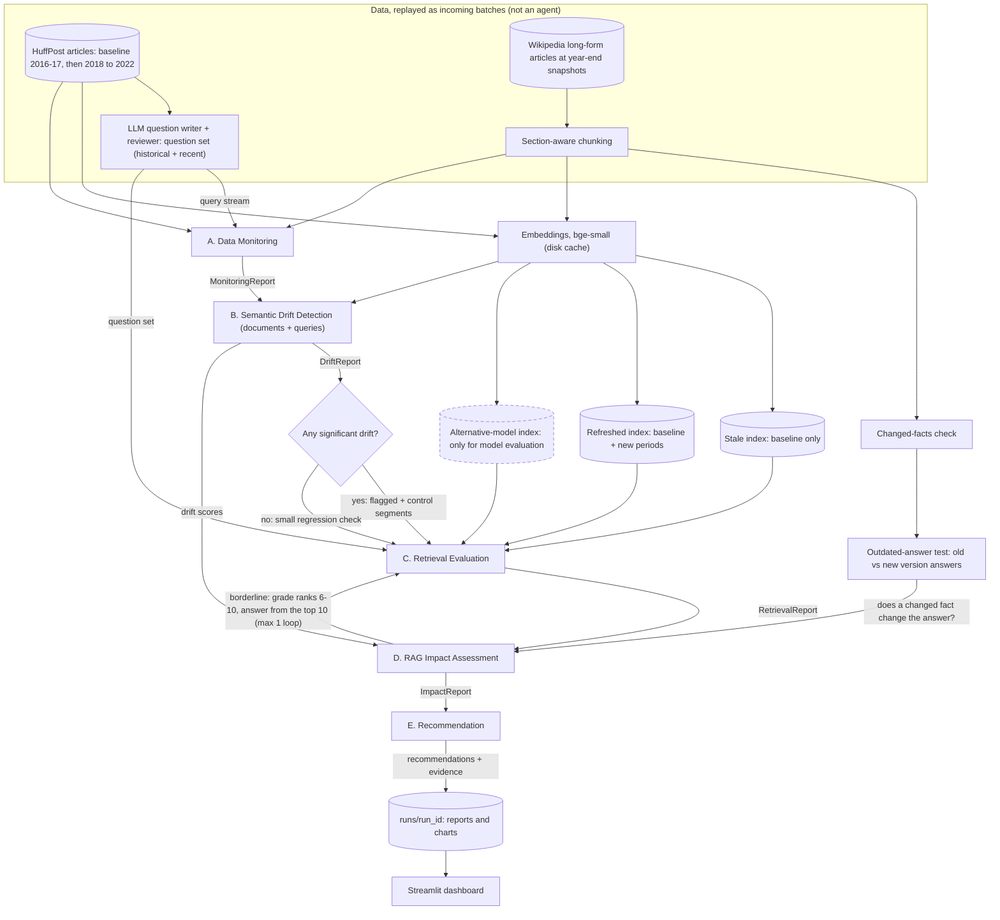

# Design summary for feedback

> **Kept as sent (2026-11-07).** A record of what the stakeholder saw, not
> the current results. Two things have changed since: drift multiples are
> now quoted on the pipeline's scale (2020 is 2.5×, not 5.7×; D30), and
> Agents C-E have been run (F15, F20-F24). Current numbers: `README.md` and
> `docs/findings.md`.

**Project:** Semantic Drift Detection & RAG Quality Assurance\
**To:** Ani · **From:** Rahul · **Date:** 2026-11-07 (first version 2026-11-06) · **Due:** Friday 2026-11-13

## 1. The problem and use case

A **newsroom archive assistant**: journalists ask questions over their own
article archive. As the news changes, the archive and the questions drift.
The system has to answer one question: **which drift matters**, meaning
which drift actually makes retrieval or answers worse, and what to do about
it.

## 2. Data

| Set | What | Why |
|---|---|---|
| **HuffPost News Category** (time-based drift) | 77,840 cleaned articles. Baseline 2016–17; new data arrives one year at a time, 2018–2022 | Real, dated drift with a known event to check against (COVID in 2020) |
| **Wikipedia, long-form** (chunking) | 165 long articles, each captured as it stood at the end of each year, 2016–2022 | Long documents with sections, so chunking matters. The same article is edited over time, which is the "documents become outdated" case. Same years as HuffPost. |

## 3. Architecture and agents (LangGraph)

Each agent reads the previous agents' reports. Statistics and decisions are
plain, tested Python. The LLM writes test questions, answers, judgements and
explanations, but never makes the decision.

| Agent | Does | Status |
|---|---|---|
| **A. Data Monitoring** | Baseline snapshot. Tracks volume, length, category mix, new terms and new sections, for documents and for incoming queries | Built |
| **B. Semantic Drift** | Two techniques: embedding drift (MMD with a permutation test, centroid shift, novelty) and word drift (Jensen–Shannon divergence, log-odds emerging terms). Per period and per section. Severity is measured against ordinary year-to-year change, not just p-values. Also emerging topics, changing word meanings, and query drift | Built |
| *Route* | If nothing drifted, C runs a small regression check only | Built |
| **C. Retrieval Evaluation** | The key experiment: a **stale index** (baseline only) vs a **refreshed index** (with new data), on the same questions. LLM-judged precision@5, nDCG@5 and "answer in the top 5", plus MRR and Recall@10, with bootstrap confidence intervals. Results split by drifted vs control sections, and by whether old questions get pushed out by newer articles | Built and run |
| **D. RAG Impact** | Answers every question from both indexes; each answer graded on its own for correctness and groundedness, blind to the index. Loss per section with a confidence interval; labels each section as drift that hurts / drift that doesn't / harm without drift / healthy; relates drift scores to the loss. Borderline sections go back to C once for more evidence. On Wikipedia, tests whether changed facts change the answers | Built and run |
| **E. Recommendation** | Rules map evidence to the brief's actions (monitor, re-index, re-index specific documents, chunking, retrieval settings, prompts, model evaluation, human review). Every recommendation must cite its evidence or it is rejected; the LLM explains, and any number not in the evidence is rejected | Built and run |

Dashboard: Streamlit, reading saved runs, so it works without an API key.

**Data flow:**

Solid boxes are built and tested; dashed boxes are designed, not built yet.

## 4. Results so far (HuffPost)

- **2020 is the largest shift:** 5.7× an ordinary year in embedding drift.
  The most affected sections were lifestyle ones (Wellness, Food & Drink,
  Style), not politics.
- **Emerging terms match real events:** coronavirus and covid (2020),
  vaccine and capitol (2021), Russia and invasion (2022).
- **The two techniques disagree after 2020:** embedding drift eases while
  word drift keeps rising. That shows they measure different things.
- **Year-on-year monitoring alone misses drift:** 2022 vs 2021 looks
  ordinary (1.2×), but 2022 vs the baseline is 4.7×.
- **Query drift** is significant for every year (q ≤ 0.008). Word drift
  peaks in 2020–21 (coronavirus, covid, capitol).
- **Stale vs refreshed index, retrieval and answers** (438 questions; Opus
  grades blind to which index was used):

  | Questions from | Answer in top 5 (stale / refreshed) | Correct answers (stale / refreshed) |
  |---|---|---|
  | 2016-17 (baseline, the control) | 100% / 100% | 100% / 100% |
  | 2018 to 2022 | 0–1% / 96–100% | 0–1% / 96–100% |

  - Without re-indexing, questions about new events fail almost completely.
    The stale index returns related but wrong articles: a 2020 question about
    takeout during the pandemic gets 2016 hepatitis and E. coli stories.
  - **It fails silently, not wrongly:** the assistant says the archive does
    not have the answer instead of guessing (1 answer in 438 added a detail
    from memory).
  - Re-indexing does not hurt old questions, even though by 2022 14% of
    their top 10 are newer articles.
  - **Drift scores do not predict where the harm is.** Every section with
    enough questions lost answers: 7 flagged by drift detection and 12 not
    (for example politics 2018–2020). No drift measure correlates
    significantly with the size of the loss. New events in a familiar topic
    do not shift a section's overall profile. On a news archive, the drift
    that matters is new content missing from the index: re-index on a
    schedule, and use drift scores to explain and prioritise.

## 5. Test questions and how they are validated

No real query log exists, so Sonnet writes questions from sampled articles
and Opus reviews them.

- **Validation:**
  - code checks;
  - two independent reviews per question;
  - the writer's and reviewer's question types are compared (85% agree);
  - the reviewer agrees with itself 95% of the time on a repeat review.
- **Result:** 423 answerable and 15 unanswerable questions kept, out of 653.
- **Hand check:** two people labelled the same blind sample of 50 items,
  independently.

  | | Person vs person | LLM vs each person |
  |---|---|---|
  | Relevance judge, "answers or not" | 12/15 | 14/15 and 11/15 (stricter, almost never more lenient) |
  | Question reviewer | 13/15 | 10/15 each (stricter than both people) |
  | Changed-facts check | 17/20 | 17/20 and 16/20 (80–85% precision) |

  Answer judge vs one person: 11/15 blind; all clear cases match, the 4
  differences are borderline partial answers.
- **Total LLM spend so far:** about $15.60, using our own key.

## 6. Chunking strategy and how it affects drift detection

Data: 165 Wikipedia articles (a random sample across topics, plus a few
tied to known events), each as it stood at the end of every year,
2016–2022. Every article is longer than the 512 tokens the model reads
(median about 8,000), so without chunking about 90% of each article would
never be seen.

**Strategy:**
- Split at section headings first, so a chunk never mixes two sections.
- Then make pieces of about 256 tokens with about 32 tokens of overlap. The
  embedding model (bge-small) reads at most 512 tokens.

**Why it matters for drift:** a long article has two common shortcuts, and
both hide drift.
- Embedding only the first 512 tokens makes a change further down
  invisible.
- Averaging one vector over the whole article dilutes a small new section
  into the rest.

**Result:** we compared each article with its own 2017 version, knowing
exactly how much text was new or rewritten. How well each way of reading
the article follows that real change (rank correlation, 1 = perfect):
first 512 tokens only 0.51; one averaged vector 0.78 (and its scores are
too small to set an alert threshold); chunks of about 256 tokens 0.87.
Articles tied to known events (COVID-19, vaccines, Ukraine) change 4.3
times an ordinary year of editing in 2020; the random sample stays
ordinary. One lesson: for documents that are edited rather than replaced,
drift has to be measured per document against its own earlier version.

**A blind spot, and how it was closed:** when only a number changes
("killed over 75 million" became "over 20 million"), the vectors barely
move (about 16 times less than a typical edit), so drift scores alone miss
changed facts.
- **Detect:** a plain text check matches each edited sentence with its
  previous version and flags replaced numbers and dates. About one article
  in five changes a fact each year, almost always with a "low" drift
  score. Two labellers put its precision at 85%.
- **Measure the harm:** questions written from 60 flagged edits and 60
  edits that kept their numbers, answered from the old and the new version
  of the archive. Flagged edits changed the answer **50%** of the time,
  against **2%** (p < 0.001). The old index still finds the edited passage
  (92%), so it serves the outdated fact with full confidence, e.g.
  German tourism's GDP contribution "over EUR43.2 billion" vs "over
  €105.3 billion".
- **Act:** Agent E recommends re-indexing the 90 articles with changed
  facts (391 changed numbers or dates since the index was built), citing
  the sentences and the 50% vs 2% result.

## 7. Main assumptions and limitations

- Years are replayed as incoming batches to simulate continuous monitoring.
- The questions are written from each period's articles, so query drift
  partly mirrors document drift.
- The LLM judges are checked against hand labels from two people, not
  replaced by them; samples are small (15–20 items per part).
- The LLM has read Wikipedia, so answers are judged on whether they are
  grounded in the retrieved text.
- The changed-facts check covers numbers and dates, not changed names (for
  example a new office holder).

## 8. Feedback welcome on

1. The main recommendation for the news archive will be scheduled
   re-indexing, with drift used to explain and prioritise rather than to
   trigger it. Does that fit what you expect?
2. For the bonus, is a targeted re-index of the Wikipedia articles with
   changed facts, followed by a re-check, a good choice of fix?
3. Does comparing whole-article and chunked drift detection answer "how
   chunking affects drift detection" in the way you expected?
