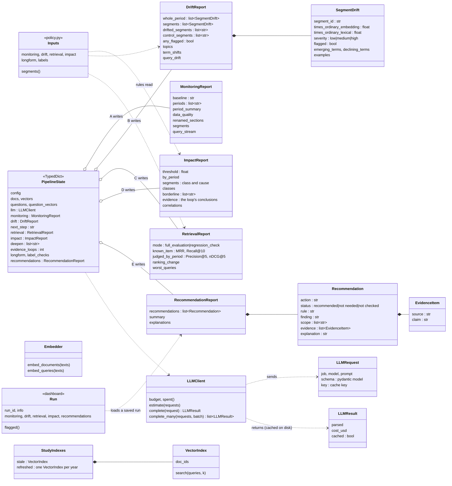
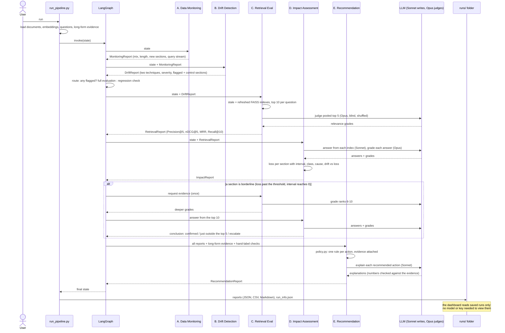

# UML diagrams

Three views of the final codebase, drawn from the code itself (imports in
`driftmon/`, the report classes in `driftmon/schemas.py`, the graph in
`driftmon/graph.py`). GitHub renders them; for the reasons behind the design,
see [`architecture.md`](architecture.md) and [`decisions.md`](decisions.md).

1. [Packages and dependencies](#1-packages-and-dependencies): which module uses which.
2. [Classes](#2-classes): the reports the agents pass to each other, and the core classes.
3. [Sequence of one run](#3-sequence-of-one-run): what happens, in order, including the evidence loop.

Dark-theme PNG exports for slides are in [`uml/`](uml/) (`1_packages.png`,
`2_classes.png`, `3_sequence.png`). They were exported with the Mermaid CLI
(`npx @mermaid-js/mermaid-cli`, dark theme, background `#0D1725`, scale 2);
re-export them after editing a diagram here.

## 1. Packages and dependencies

A layered view: each layer uses the layers below it, never the ones above.
The rule the layout enforces: statistics and decisions (`drift/`,
`evaluation/`, `policy.py`) are plain, tested Python; the LLM is reached only
through `llm/`, and only to write, judge and explain. The exact imports are in
the table under the diagram.

```mermaid
flowchart LR
    subgraph L1["Entry points"]
        SCRIPTS["scripts/<br/>run_pipeline, export_demo,<br/>experiments"]
        APP["app/<br/>Streamlit dashboard"]
    end
    subgraph L2["Orchestration"]
        GRAPH["graph.py<br/>LangGraph: nodes, routes, evidence loop"]
    end
    subgraph L3["Agents (thin LangGraph nodes)"]
        AG["A. data_monitoring<br/>B. drift_detection<br/>C. retrieval_eval<br/>D. impact_assessment<br/>E. recommendation"]
    end
    subgraph L4["Tested logic: statistics, metrics, rules"]
        DATA["data/"]
        DRIFT["drift/"]
        EVAL["evaluation/"]
        POLICY["policy.py"]
        DASH["dashboard/"]
    end
    subgraph L5["Infrastructure"]
        RAG["rag/<br/>embeddings, FAISS index"]
        LLM["llm/<br/>client, prompts"]
        LONG["longform/<br/>Wikipedia, chunking"]
    end
    subgraph L6["Shared by all"]
        SCHEMAS["schemas.py<br/>typed reports, PipelineState"]
        CONFIG["config.py<br/>config/config.yaml"]
    end

    L1 --> L2
    L2 --> L3
    L3 --> L4
    L4 --> L5
    L5 --> L6
```

| Package | Imports from |
|---|---|
| `scripts/` | graph, agents, data, drift, evaluation, rag, llm, longform, dashboard, schemas, config |
| `app/` | dashboard, policy, config |
| `graph.py` | agents, schemas |
| `agents/` (A) | data, drift, schemas, config |
| `agents/` (B) | data, drift, schemas |
| `agents/` (C) | evaluation, rag (index, simulated failure), data, schemas, config |
| `agents/` (D) | evaluation, llm (client), data, schemas |
| `agents/` (E) | policy, llm (client, prompts), schemas |
| `data/` | drift, evaluation, rag, llm, config |
| `drift/` | data, evaluation, rag, schemas |
| `evaluation/` | data, drift, rag, llm |
| `policy.py` | evaluation, schemas |
| `dashboard/` | policy, longform, schemas, config |
| `rag/`, `llm/`, `longform/` | config only |

`data/`, `drift/` and `evaluation/` share helpers in both directions (for
example, the drift statistics are reused to measure query drift), so they
form one layer. `data/` and `evaluation/` import `llm/` only to *build*
requests (questions, answers, judgements); every decision on the results is
made in code.

## 2. Classes

The agents communicate only through these typed reports, held in one shared
state. Each agent is a function `(PipelineState) -> partial state` that reads
earlier reports and adds its own.

## 3. Sequence of one run

`python scripts/run_pipeline.py`: the graph runs A to E; after B it chooses
the full or a small check; after D a borderline section goes back to C once
(the evidence loop, D28; it fired only on the simulated failed re-index,
F26). The LLM is called only where shown; every reply is cached, so a rerun
costs nothing.

